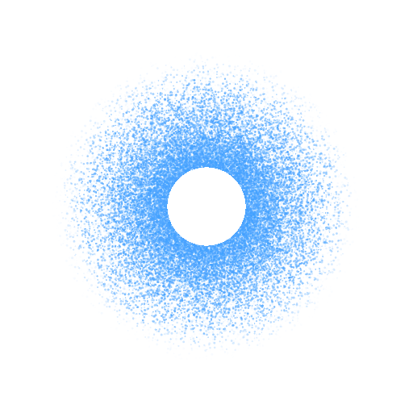

import StateLifetimes from "./exhibits/state-lifetimes.tsx" with {
  type: "code",
};
import MotionKeyframes from "./exhibits/motion-keyframes.tsx" with {
  type: "code",
};
import ConfigurableCanvas from "./exhibits/configurable-canvas.tsx" with {
  type: "code",
};
import { Tonnage } from "tonnage";
import config from "./tonnage.config.ts";
import StoreExample from "./exhibits/store.tsx" with { type: "code" };
import RootBoundaryExample from "./exhibits/root-boundary.tsx" with {
  type: "code",
};
import CommitExample from "./exhibits/hooks/on-commit.tsx" with { type: "code" };
import Families from "./exhibits/families.tsx" with { type: "code" };
import HotState from "./exhibits/hmr-state.ts" with { type: "code" };
import HotView from "./exhibits/hmr-view.tsx" with { type: "code" };
import TimelineExample from "./exhibits/timeline.tsx" with { type: "code" };
import LoadableExample from "./exhibits/loadable.tsx" with { type: "code" };
import Point from "./exhibits/point.tsx" with { type: "code" };
import ViteConfig from "./exhibits/vite.config.ts" with { type: "code" };
import Main from "./exhibits/main.tsx" with { type: "code" };
import Types from "./exhibits/tsconfig.json" with { type: "code" };
import AstroConfig from "./exhibits/astro.config.ts" with { type: "code" };
import AsyncAstro from "./exhibits/async-astro.tsx" with { type: "code" };
import Counter from "./exhibits/Counter.tsx" with { type: "code" };
import CounterPage from "./exhibits/counter-page.astro" with { type: "code" };
import VitePage from "./exhibits/index.html" with { type: "code" };
import CreateAstroTemplate from "./exhibits/create-astro-template.sh" with {
  type: "code",
};
import Verify from "./exhibits/verify.sh" with { type: "code" };
import KonvaExample from "./exhibits/konva.tsx" with { type: "code" };
import ThreeExample from "./exhibits/three.tsx" with { type: "code" };
import MotionPanel from "./exhibits/motion.tsx" with { type: "code" };
import MotionMain from "./exhibits/motion-main.tsx" with { type: "code" };
import MotionExit from "./exhibits/motion-exit.tsx" with { type: "code" };
import MotionThree from "./exhibits/motion-three.tsx" with { type: "code" };
import InstallFloating from "./exhibits/install-floating.sh" with {
  type: "code",
};
import LayoutExample from "./exhibits/layout.tsx" with { type: "code" };
import LayoutMain from "./exhibits/layout-main.tsx" with { type: "code" };
import FloatingMain from "./exhibits/floating-main.tsx" with { type: "code" };
import FloatingExample from "./exhibits/floating.tsx" with { type: "code" };

  

# SPA

An experimental JSX framework whose state engine is atom.io. Components run once per mounted instance. Calls to accessors inside compiled JSX subscribe the affected DOM computations; atom.io updates those computations without rerunning component setup.

The npm package is named @atom.io/spa. Its browser runtime, Vite compiler, server renderer, and Astro integration are implemented here. State and general reactions belong to atom.io.

## Start with the Astro template

Use the [SPA + Astro SSR template](https://github.com/jeremybanka/atom.io/tree/main/templates/spa-astro-ssr) for a ready-to-run application with Astro islands, resumable initial data, SQLite, and tRPC:

<CreateAstroTemplate />

For manual setup, see the [Astro](https://atom.io.fyi/docs/spa/astro) and [Vite](https://atom.io.fyi/docs/spa/vite) integration guides on atom.io.fyi.

## A point, not two signals

<Point />

Name the getter and setter after the atom: pointAtom uses getPoint and setPoint. The getPoint getter returns the current object. Each JSX attribute reads its coordinate when evaluated. Both bindings depend on the point atom, and unchanged primitive results skip DOM writes. Reads during setup are snapshots; reads in event handlers are current and untracked. Shared derived state belongs in atom.io selectors.

Component children follow the same getter contract as named props. A component declaring string children reads a string for both literal text and expression children, including an explicit children attribute. Read props.children inside compiled JSX or a tracked binding for reactive updates; setup reads capture a snapshot. Deliberately function-valued children remain functions, including render callbacks.

## Astro

Register the Astro integration, which compiles .tsx and .jsx components by default:

<AstroConfig />

Create a counter component:

<Counter />

Import it into an Astro page and use client:load to make it interactive. Astro handles server rendering and browser hydration:

<CounterPage />

## Vite

Add @atom.io/spa and atom.io to the application's dependencies. The spa plugin is required: the ordinary TypeScript JSX transform cannot preserve live expressions. It compiles expressions into lazy child computations and property getters; it also preserves spread precedence and live component props.

<ViteConfig />

<Types />

Add a host element in index.html, then mount the same counter from main.tsx:

<VitePage />

<Main />

The development plugin keeps SPA and atom.io outside dependency prebundling so renderer entrypoints, component hooks, and stores share one runtime, including Astro adapter environments. Component-only JSX modules refresh affected roots against their existing atom.io stores; production builds omit hot registration. Components and render computations are synchronous. Modern browsers with ES2022 and DOM Range support are the target.

Hot updates rerun affected roots, including scene roots and independent Astro islands, with the same store and props source. Old scopes release subscriptions, listeners, refs, and onCleanup callbacks before replacement. Atoms, persistent family members, and timeline history remain; DOM-local values and component-owned family members disposed by cleanup reset. A failed hot setup displays an error while keeping its store available for the next edit.

Keep state definitions and Astro store factories in separate modules from component-only views. State declarations, mixed runtime exports, re-exports, changed export boundaries, and top-level side effects use full reloads. Type-only exports are allowed. The first implementation refreshes complete roots rather than replacing individual component instances.

Define persistent tokens in their own state module:

<HotState />

Import the token from a component-only view. Editing this view's JSX or handler preserves the counter value:

<HotView />

## Hooks

| API                           | Contract                                                                                                                 |
| ----------------------------- | ------------------------------------------------------------------------------------------------------------------------ |
| useLoadable(token, fallback?) | Return a tracked accessor for loading, last-observed values, and handled errors.                                         |
| useGetter(token)              | Return a live accessor for an atom or selector, bound to this instance's store.                                          |
| useDisposal()                 | Return atom.io state disposal bound to the current store.                                                                |
| useSetter(token)              | Return a stable atom.io writer.                                                                                          |
| useTimeline(token)            | Return a stable object with getCursor/getLength readers, undo/redo/clear commands, and transaction-group controls.       |
| useTransaction(token)         | Bind an atom.io transaction, preserving its arguments and result.                                                        |
| useRef(token)                 | Return an attachment callback for a nullable element atom. Clear it only while this attachment still owns the reference. |
| useId()                       | Allocate an instance-stable ID using the current prefix and the root's shared sequence.                                  |
| onCleanup(callback)           | Register synchronous teardown with the current owner.                                                                    |
| onMount(callback)             | Run once after attachment and ref publication; omitted during server rendering.                                          |
| onCommit(read, apply)         | Track a value and apply changes after renderer writes, within the same flush.                                            |
| useStore()                    | Return the current atom.io store without creating a store or subscribing.                                                |

Call setup helpers synchronously during component setup or owned mount callbacks. Capture their results for event handlers. Tokens are fixed for an instance. Change the component's key when it needs to bind a different token. Read data props through the props object in JSX or a tracked binding to get updates. Destructuring data props during setup takes a snapshot.

### onCommit

Use onCommit to measure a ref after the root finishes its DOM writes.

<CommitExample />

Call onCommit during setup. Its read function tracks state and compares the result with the last applied value using Object.is. The untracked apply callback receives the value and the previous applied value, which is undefined on mount. It runs after ref publication, mount callbacks, controlled form restoration, and capability commits. A flush inside a controlled form handler defers apply until restoration can finish. Children run before parents, with sibling callbacks in setup order.

A cleanup returned by apply runs before the next apply and when the owner is disposed. State writes from apply drain in another round of the same flush. Development detects feedback loops and reports the callback's registration stack. Scene callbacks run after host updates. Server rendering skips both callbacks, and scopes retained for exit skip apply while absent.

useTimeline returns a TimelineControls object whose methods can be destructured during setup. getCursor and getLength read the current cursor position and recorded checkpoint count; calls inside JSX subscribe the computation, while calls during setup or in event handlers are untracked. undo, redo, and clear are stable commands. history.getTransaction() is a tracked reader that returns an object with optional undo and redo callbacks for the adjacent transaction groups. At a cursor between transactions, both callbacks may be present and target different groups. A missing callback means no transaction group is available in that direction; the reader returns an empty object when neither is available. Calling a returned callback travels its captured group across participating timelines where it remains at the relevant history head, leaving diverged timelines unchanged. Use history.getTransaction().undo?.() or history.getTransaction().redo?.() to retrieve and invoke the current action together.

<TimelineExample />

HTML and SVG use native DOM properties and attributes, plus className/htmlFor aliases. Events use onClick/onInput-style names, with Capture suffixes and onDoubleClick support. Styles are CSS strings. Mutable atom values still invalidate their consumers; project primitive fields for precise DOM writes. Refs attach once per element instance.

HTML and SVG tags have element-specific attribute, event, and ref types. Event handlers receive native events with currentTarget typed as the attached element; target remains EventTarget because events can bubble from descendants. Ref callbacks receive the element on attachment and null on cleanup. Hyphenated custom tags use generic HTML attributes and HTMLElement refs and event targets. SVG presentation attributes use their literal markup spellings. Shared HTML/SVG tag names use HTML types because JSX cannot infer a namespace from parent elements.

Non-null value and checked props control form state: rejected edits are restored after native handlers run, and select values are reapplied after option updates. Use defaultValue/defaultChecked for uncontrolled fields. onChange follows native input events for text, number, range inputs and textareas; selects, checkboxes, radios, and file inputs use native change events. Handlers still receive native events. onFocus/onBlur bubble through focusin/focusout, including Capture variants; explicit onFocusIn/onFocusOut names remain available. autoFocus focuses newly mounted elements. Null or undefined reflected attributes are removed.

## Component identity

Keys accept the same Canonical values as atom.io families, including nested tuples, booleans, and null. Sibling keys must be unique by canonical serialization. A fresh tuple with the same contents preserves the instance, and a number and its string representation identify separate instances. Only undefined uses positional identity. Reordering preserves keyed instances and nodes. Changing a key replaces the instance in both DOM and scene trees, including when the element stands alone.

A component can declare a required, narrowed key in its props. The instance receives the original key by reference and can read props.key during setup, rendering, mount, and cleanup. Spreading the props forwards the key to an inner component or element. A spread follows normal JSX precedence, so forwarding the same key to multiple siblings reports a duplicate key.

## Store access

useStore returns the nearest Root boundary's atom.io store. When no boundary supplies one, it returns the store supplied to the renderer, the Astro island store, or the implicit atom.io store.

<StoreExample />

For family-member disposal, useDisposal() captures this store and returns a bound disposal command; see [ambient UI state](#ambient-ui-state-and-ownership). Capture the store during component setup or an owned onMount callback, then pass it to other store-aware atom.io operations or integrations. Getting the store creates no subscription. Direct reads such as getFromStore do not participate in SPA's dependency tracking; useGetter and useLoadable provide tracked reads. The returned object is a store, not a Silo or a new wrapper.

### Subtree root options

Render a Root boundary around each editor to give it a separate store with the document token installed in both stores.

<RootBoundaryExample />

Root shares its parent's scheduler and uses normal child markers and adds no DOM element. Components passed as children bind their hooks to the store where they mount. The boundary captures options at setup, so give it a new key to replace its store. Removing the boundary releases owned subscriptions and refs. The borrowed store remains available.

Omitted options inherit from the parent. An idPrefix override uses the root's shared ID sequence. A capabilities list replaces the inherited list within the subtree and shares the root's update and presence coordination. An onError override receives asynchronous errors from the subtree under the usual root failure policy. Scene mounts inherit these options. For SSR and hydration, supply equivalent boundary options and store state on both sides.

## Families

useGetter, useSetter, useRef, and useTimeline accept a family token followed by its key. useLoadable accepts a family, key, and optional fallback. Keys retain their declared types, including tuples, numbers, booleans, and null. Members resolve in the component's store, so isolated roots can use the same family tokens independently.

<Families />

Use props.key as the family key to keep the binding and the component's identity in sync. When the key changes, the new instance binds to the new member during setup. A tuple can include a family key alongside a discriminator when the same member appears more than once among siblings. Ref ownership and subscription cleanup follow the member just as they do for individual tokens. useTransaction takes an individual transaction token.

### Ambient UI state and ownership

Ambient state is useful for ephemeral UI flags that several components need to read or change, such as whether a popover is open. Define the family at module scope and give each popover an application identity. Its trigger and panel can bind to the same boolean without passing the value and setter through their parent.

This exhibit gives each toolbar its own formatting and keyboard-shortcut help popovers. Hiding formatting help removes its keyed instance and disposes its visibility state. Showing it again starts closed; the shortcuts popover and other toolbars keep their state:

<StateLifetimes />

The reconciliation key identifies a component among siblings. The family key identifies application state across the whole store: the tuple includes both the toolbar ID and help topic so separate toolbars do not share visibility by accident. The toolbar ID must be unique within that store. The renderer consumes key; pass the state identity as an ordinary prop.

Call useDisposal() without arguments during setup. It captures the current root's store and returns atom.io disposal, accepting either a family and key or an existing member token. Invoke it from an event handler or register it with onCleanup. It works with the implicit store, render/hydrate options.store, and isolated Astro stores without passing a disposal callback through props. Custom stores still need the module-scope definitions installed through Silo.install.

HelpPopover owns the visibility member shared by its trigger and panel, so it disposes that member after both consumers are removed. A single consumer must not dispose state that other live consumers still need. Shared session or application state belongs to the owner that knows when every consumer has finished. Standalone atoms persist for their store's lifetime; disposal removes family members, not standalone atoms.

Getter and setter bindings capture their family key during setup. Replacing a keyed instance changes its binding; changing an identity prop on an existing instance does not rebind it. Disposing a family member removes its stored value and resources; a later read recreates it from its default. Keep user-authored content in state whose owner matches its intended persistence, rather than treating it like a popover's transient visibility.

## Async state

<LoadableExample />

Call useLoadable during setup and read its accessor inside JSX. It also accepts a readable family and fixed key, with an optional third fallback argument. Without a fallback, the accessor returns LOADING until it observes a settled value, then an object containing loading and value. Refreshes retain the last observed value while loading. Null, undefined, and the literal string LOADING are valid settled values.

With a fallback, the accessor always returns an object. The fallback is used for initial loading and for errors declared in the token's catch option; handled errors appear separately in error. During a retry after an error, the fallback and error remain visible until a new value settles. An explicitly supplied null or undefined counts as a fallback when the token's value type permits it. Without a fallback, handled errors appear in value. Unexpected errors follow atom.io's normal error handling.

Atom.io owns promise settlement and subscriptions. SPA adds no fetching, retries, cancellation, or suspense. Reads during setup are snapshots; calls inside JSX track state. Family keys are fixed for a component instance. Server rendering returns the current loading or settled view immediately and does not await promises.

## Rendering and ownership

The client exports render and hydrate. Both accept a setup callback, a host Element, and optional store, idPrefix, and onError options, and return dispose and flush methods. Updates coalesce in a microtask; flush drains them synchronously. Dispose is idempotent and removes only owned nodes. Cleanup continues after individual cleanup failures and aggregates errors. A failed computation disposes its root; asynchronous update failures reach onError, while explicit flush failures throw.

The separate server entrypoint exports renderToString with the same setup callback and store/ID options. Supply a request-specific store for SSR. Server rendering retains no subscriptions and runs owner cleanup. Hydration reuses matching server nodes and IDs, attaches events, and recreates subscriptions. Match initial state, component structure, and valid HTML on both sides. A hydration mismatch produces one human-readable console warning per root in development and production, identifying the host and expected/found nodes. SPA repairs mismatched nodes, inserts missing nodes, and removes unexpected leftovers during the same hydration pass. Component setup and mount hooks run once, subscriptions remain active, and matching nodes are reused. Replaced nodes can lose focus, selection, or unsaved browser input; unaffected roots continue running. An explicit client idPrefix takes precedence when repairing mismatched root markers. Use explicit tbody elements in tables. Controlled form properties are applied during hydration.

The production build omits development-only diagnostics and invalid-input checks; the development export condition enables them. Hydration recovery warnings remain available in all builds. Pure render computations must not write state. Promise children, async components, portals, suspense, error boundaries, style objects, and automatic token-as-child bindings are outside this first implementation. Applications handle asynchronous data through atom.io state and synchronous conditional JSX.

## Astro state and data

The integration compiles .tsx and .jsx files by default. Use the include option to limit compilation to SPA component directories when another JSX renderer is present. Top-level functions containing JSX are branded by the compiler for renderer detection.

Default islands share the normal implicit atom.io store in the browser. Module-scoped tokens, SPA hooks, and ordinary getState/setState calls all address the same graph. SSR shares a separate store within each request; concurrent requests never share values. Definitions imported after an earlier island started are installed into that request's store before the next island prepares. Server reads and writes must use the selected store (through SPA hooks or store-aware atom.io operations); free getState/setState calls still target the process-global implicit store.

The integration starts observing browser state before island preparation. Untouched initial islands hydrate their matching server DOM. Once application state changes or a shared client:only island starts, delayed islands mount fresh against the live graph. Astro ClientRouter navigation also makes newly introduced islands mount fresh, preserving existing browser values instead of replaying the incoming server snapshot. Mounted and persisted roots keep their subscriptions and DOM. This decision is conservative across the application: even an unrelated state change disables hydration for later roots. Ordinary defaults should still produce matching initial values. DOM mismatch recovery keeps a view interactive; it does not reconstruct missing server data or resolve nondeterministic application logic.

With resumability/astro installed alongside SPA, resumability owns Astro's request collection, page sidecars, and browser scope. SPA awaits async state used by JSX and uses the host's renderer adapter to attach seeds to islands. Ordinary atom defaults use the host without changing the store's evaluator; private stores bind a separate scope so lazy work ends with the island. Define resumable defaults at module scope and render ordinary Astro islands. Components need no Resumption wrapper, prepareStore callback, or preload list. The same host supports plain Astro constants without atom.io. See the [resumability guide](https://atom.io.fyi/docs/spa/astro#resumability) and the inventory starter for a complete example. Resumability is an optional peer, loaded only by this adapter.

Server-rendered views record the state tokens they read so the browser can check readiness before hydration. If an ordinary async default is still pending without a synchronous seed, SPA mounts a fresh view with its loading state; seeded values continue to hydrate existing DOM. This also handles cached server reads and mixed ordinary/resumable state. Private server preparation and rendering are cancelled with their request, releasing cleanup resources even when a producer ignores its abort signal.

Set a component's isolate property to true to opt into a private store copied from registered definitions. An optional createStore(props, context) factory supplies a custom RootStore or promise and retains a private preparation lifetime. Custom factories that return the same store are responsible for coordinating their hydration and cleanup. Keep atom definitions at module scope in either mode.

An optional prepareStore(store, props, context) callback initializes the selected store and may return a promise. SPA awaits it before component setup on the server and browser. Existing one-argument synchronous factories still work. Shared preparation must be safe to call for multiple islands; use context.application.get(key, initialize) to create an application resource once.

The context provides element (the browser astro-island host, undefined on the server), signal, and onCleanup for the individual island. Its application provides get, signal, onCleanup, and canResume for the shared lifetime. Browser application resources survive island removal and ClientRouter navigation; they end on a full page exit, with back/forward-cache suspension preserved. SSR application resources end after the response stream finishes or is cancelled. Private islands' application resources end with the island. Use application cleanup and cancellation for shared fetches or resumption scopes; use the outer context for resources owned by one island.

Register cleanup as resources are acquired, before awaiting work that might fail. Cleanup callbacks run in reverse order and all run even if one throws; callbacks registered after cancellation run immediately. Cancelling an island stops its wait and prevents a stale mount without cancelling shared application work. Producers must honor their owner's signal to stop I/O. The example below explicitly isolates its per-island data preparation:

<AsyncAstro />

AstroApplicationContext, AstroStoreContext, AstroStoreFactory, AstroStorePreparation, and Island types are exported from @atom.io/spa/astro. Preparation runs before component setup, so use the context's cleanup registrar there; use SPA's onCleanup inside components. Preparation failures reject the Astro render or hydration operation, retaining cleanup errors alongside the original failure. The factory and preparation callback are awaited per render; component setup and the standalone renderToString API remain synchronous.

Astro client:load, client:idle, client:visible, client:media, and client:only use Astro's scheduling. The integration hydrates eligible initial server markup or renders fresh content and releases the root on astro:unmount. Default slot content arrives as children and named content through slots. Reserved astro-slot wrappers contain Astro's already-rendered HTML; never use their innerHTML escape hatch for untrusted strings.

Persisted islands receive live prop and slot updates without rerunning component setup or recreating their store. Repeated hydration calls during preparation share one factory and preparation invocation. New client mounts use the latest props and slots; hydration attaches to the original server tree first, then applies any changes received while preparing. The factory receives the initial props and runs only when an island is first mounted; put changing values in props rather than relying on the factory to run again.

The checked Astro fixture demonstrates default/named slots and custom independently initialized islands, including client:only. The spa-astro-ssr template demonstrates shared state, server-data resumption, delayed islands, and navigation without losing edits.

## Size and verification

The build audits every browser export, including the JSX runtime, from the built JavaScript. Atom.io is an external peer in the incremental measurement. Compiler, server, and integration code have separate entrypoints. The report also includes the complete client plus atom.io, the Astro client entrypoint, and the installed Preact version under the same bundling/minification settings. These are full exported surfaces, not equivalent application benchmarks.

The hard budget is under 6,250 bytes of ordinary level-9 gzip for the complete client export surface, including hydration recovery and its production diagnostics. Tsdown builds the package JavaScript and declarations, with separate production and development outputs that each share their runtime across entrypoints. The size audit then bundles the built exports with esbuild, minifies with Oxc, and measures compression using Node's gzip and Brotli implementations. The complete client export surface measures approximately 6.2 kB with gzip. The exact measurements appear in dist/size.json. Actual application bundles add atom.io and compiler-generated application code.

Build output includes the minified audit entrypoint and machine-readable dist/size.json. These audit files are a bundled measurement; use the package exports in applications so the bundler preserves one runtime instance across entrypoints. Source tests exercise development behavior; the production test executes the audited minified artifact. Chromium checks exercise the actual Astro build, island isolation, hydration, keyed identity, focus/selection, SVG namespaces, and teardown. A fresh-cache Astro development check also covers mount hooks, shared state, and ClientRouter navigation.

<Verify />

## Package checks

Breakage exercises the packed package in isolated, locked peer environments, including the coordinated atom.io workspace candidate. Until the first published release, Breakage reports a first-release baseline; these checks establish compatibility with the declared peers rather than a previous spa release. Coverage gates require 100% of statements, branches, functions, and lines across the package source.

Tonnage measures combined browser bundles containing SPA and atom.io, with shared modules counted once and unused exports removed. The synchronous recipes include atom creation, useGetter, useSetter, and JSX; the client recipe adds render, the hydration recipe adds hydrate, and the Astro recipe adds the browser island adapter. The async recipe uses useLoadable with render and useSetter. The family recipe includes keyed state, refs, and timeline controls, plus atomFamily, timelineFamily, and scopeFamily. SPA declares atom.io as a peer dependency; these consumer-app measurements include it in every total. Application components, Astro scheduling code, CSS, declarations, and source maps are excluded. The full-client gzip budget above remains a separate, SPA-only audit.

<Tonnage config={config} />

## License

MPL-2.0 or later. See [LICENSE](./LICENSE).

## Optional graphics and motion

SPA includes Konva, Three.js, and Motion integrations behind separate entrypoints. Install only the engines you use. Konva, three, @types/three, and motion are optional peers; the main runtime and JSX declarations work without them installed. Importing the base entrypoint does not load any animation or graphics engine, and each integration's bundle excludes the other engines. These boundaries are verified with isolated consumer and bundle checks.

### Konva

Import Stage, Layer, Group, Rect, Circle, Ellipse, Line, Text, Image, Path, Star, and Transformer from @atom.io/spa/konva. Stage renders a DOM container and creates its native stage after browser mounting. Compiled atom reads update native attributes; keyed children preserve node identity. Native configuration attributes and mouse, pointer, touch, wheel, context-menu, drag, and transform handlers are supported with typed native Konva events and node-specific currentTarget values. Use onDblClick/onDblTap for double clicks/taps. Both onGotPointerCapture and onLostPointerCapture expose PointerEvent values. onTransformEnd may receive an undefined evt when stopTransform() ends a transform programmatically; check evt before reading native event fields. Handler names and configuration fields are checked for misspellings. Refs receive native nodes and null on cleanup. Removal destroys owned nodes and listeners.

<KonvaExample />

Konva owns hit testing, dragging, and draw batching. Write drag results back into atoms to keep document state synchronized. The exported konvaRenderer can also render into a borrowed container dedicated to its scene children.

### Three.js

Import Canvas, Group, Mesh, PerspectiveCamera, AmbientLight, DirectionalLight, BoxGeometry, SphereGeometry, PlaneGeometry, MeshStandardMaterial, MeshBasicMaterial, and MeshNormalMaterial from @atom.io/spa/three. Canvas creates a WebGL renderer after browser mounting. Geometry and material children attach to their Mesh, with one of each supported. Position and rotation accept three-number tuples; scale also accepts a scalar.

<ThreeExample />

Mesh accepts optional constructor args typed from Three.js, including custom BufferGeometry and a Material or material array. Resources supplied in args are borrowed: their application owner disposes them after all consumers finish. JSX geometry/material children and implicit Mesh defaults remain renderer-owned. Constructor args are fixed for the mounted instance; use a new reconciliation key to replace them.

Constructor args are fixed for an instance. Change the resource's key to replace it with new constructor args. Refs expose native objects. Owned geometries and materials are disposed on removal; textures passed through material properties remain borrowed. Canvas stops drawing and disposes its renderer on removal. The exported threeRenderer renders into a borrowed parent dedicated to its children without creating a WebGL renderer.

Canvas accepts rendererOptions for constructor-time settings such as alpha and powerPreference, or createRenderer to construct the renderer with the supplied canvas. Both paths are exclusively owned by Canvas: it disposes the renderer on removal or setup failure, and the factory must return a renderer using that canvas. Shared/borrowed renderers are not supported by this boundary; use threeRenderer for a separately owned renderer. Options and the factory are captured at mount; replace the keyed Canvas to reconstruct its context.

Use onCreated to configure tone mapping, output color space, scene background, or controls after the scene mounts and sizes, before the first draw. Return a cleanup callback for controls or other acquired resources. Numeric dpr selects a fixed positive ratio; a min/max tuple clamps devicePixelRatio and follows window resize events. The default remains 1. Width and height remain reactive positive CSS-pixel dimensions. Canvas updates its default perspective camera projection; supplied cameras are borrowed and retain their own projection. Use onResize to update an external perspective/orthographic camera explicitly. onFrame and pointer routing always use the current camera prop, with one frame loop using the installed Motion clock or requestAnimationFrame.

<ConfigurableCanvas />

Canvas defaults to a perspective camera at z = 5. Its optional camera prop borrows an external camera; a PerspectiveCamera child does not automatically become active. Width and height update the renderer and default camera. Canvas renders continuously and accepts an onFrame callback with scene, camera, renderer, delta seconds, and timestamp seconds. Controls, asset loading, and drawing on demand are outside this initial API.

### Three.js pointer events

Mesh and group components accept onPointerDown, onPointerUp, onPointerMove, onPointerEnter, onPointerLeave, onPointerOver, onPointerOut, onPointerCancel, and onClick handlers. Canvas converts CSS pointer coordinates into a ray through the current camera, updates world matrices, and picks the nearest visible object on the camera's layers. That object occludes objects behind it even when it has no handlers. Three.js material sidedness controls which surfaces can be picked.

Events bubble from the picked object through its scene ancestors; stopPropagation stops ancestor delivery. Enter and leave notifications describe each ancestor's hover boundary without repeating when moving between its children. Hover is tracked per pointer and re-evaluated each frame, so moving objects and cameras update hover even when the pointer stays still. Hidden ancestry and hidden materials are excluded.

A ThreePointerEvent exposes nativeEvent, target (the receiving leaf or captured object), currentTarget (the handler's object), intersection, ray, pointerId, button, buttons, clientX, clientY, preventDefault, stopPropagation, and setPointerCapture/releasePointerCapture/hasPointerCapture methods scoped to that handler's object. Capturing on a group retargets subsequent events to that group. Off-object captured events retain the capture's last intersection; use the current ray for drag-plane calculations. A primary-button click is emitted only when press and release pick the same leaf.

Canvas retains native pointer delivery during a press. Releasing outside a pressed object cancels it unless a scene object explicitly captured the pointer; captured objects still receive the release outside the canvas. Pointer cancellation, browser capture loss, subtree removal, and Canvas disposal clear interaction state and release native capture. Cleanup continues if removal callbacks fail. Borrowed scenes can use createThreeEvents directly, call update after changing the scene, remove to release a subtree's interaction state, and dispose when the surface is released.

### Declarative motion capabilities

Import motionCapability from @atom.io/spa/motion and register it explicitly in render or hydrate options. Importing that entrypoint also supplies JSX type augmentation. Registration belongs to one root, is inherited by its scene subtrees, and never modifies a global registry. Astro islands can set their component's capabilities property to the same array; the integration supplies it to both server rendering and browser hydration.

<MotionMain />

Use motion:initial, motion:animate, motion:exit, motion:transition, motion:whileHover, and motion:whileTap directly on native elements or custom tags. These are framework properties, separate from native attributes: they never become HTML attributes. An unregistered namespace or unsupported motion property produces an error. Standard XML, XMLNS, and XLink attribute namespaces retain their normal behavior.

<MotionPanel />

Motion targets update reactively without rerunning component setup. The target stays in atom.io; intermediate values and velocity remain in Motion. Spring transitions preserve motion-value continuity when retargeted. Duration-based tween transitions are also supported. Set initial to false to start at the animate target’s final value. DOM targets accept scalar CSS values and independent transforms, including custom CSS properties. DOM keyframe sequences and property-specific timing are supported as described below. Use motion:layout for layout changes and motion:layoutId for shared element transitions.

Motion respects the user's reduced-motion preference by default, including changes while mounted. The capability's reducedMotion option can be user, always, or never. Owner cleanup stops animations and releases effects, gesture handlers, and media-query listeners. Removing the capability properties releases that node's binding. Avoid assigning the same property through both native attributes/styles and motion targets: motion owns the properties it animates.

The same attributes animate numeric Konva properties and colors, or Three.js position, rotation, scale, light/material color, opacity, and intensity. Three.js rotation uses Euler components, not quaternion interpolation. DOM hover and tap use Motion's gesture handling; Konva gestures use native pointer events. Three.js gestures use the same raycast event layer as ordinary scene pointer handlers.

<MotionThree />

When the motion capability is installed, Canvas draws in Motion's post-render phase after animated scene values update. Without it, Canvas uses requestAnimationFrame. Both drawing subscriptions and animations end with their owners. The base runtime imports no motion engine or retention coordinator. The optional Motion entrypoint owns the retention machinery. The client budget includes controlled form restoration and native event normalization. The full client budget is 5,500 bytes.

### Exit animations and re-entry

Declare motion:exit on an element, custom tag, Konva node, or Three.js scene node. Conditional or keyed removal starts that target from its current Motion values. No presence wrapper is required. Register motionCapability as above.

<MotionExit />

In the repository, the runnable source lives in [examples/motion](https://github.com/jeremybanka/atom.io/tree/main/packages/spa/examples/motion), including its standalone Vite entrypoint and visual recorder. Run the package’s example:motion script to start it locally.

Try the [motion sandbox](https://atom.io.fyi/spa-motion-lab) to interrupt a 2s tween at adjustable speeds, inspect rendered positions and velocities, scrub the captured sequence, or export PNG and JSON evidence.

SPA retains the entire removed subtree until all its exit targets finish, including independently exiting descendants adopted by an exiting ancestor. Native nodes, scene attachments, refs, subscriptions, renderers, geometries, and materials remain owned until final disposal. When keyed Mesh resources are replaced, the incoming geometry and material attach immediately; outgoing resources remain owned through their exits without occupying those attachment slots. Removing a resource without a replacement keeps it attached until its exit finishes. Replacing resources does not render a crossfade between them. Siblings keep their instances; retained ranges keep their previous position. A target without an exit is removed immediately unless another exit retains its enclosing subtree.

Returning the same key and component or element type before disposal cancels the exit and resumes the original instance against the latest props and state. Setup, mount callbacks, and refs do not run again. Motion keeps the current animated values and spring velocity. Moving numeric tweens also preserve velocity, including matching CSS units and scene tuple components: the first 20% of the new duration brakes to rest, then the remaining 80% returns smoothly to the latest animate target. Interrupted tweens begin immediately and use this return curve instead of restarting their authored delay or easing. Fresh tweens keep their authored timing, and zero-duration or reduced-motion updates remain immediate. Discrete and nonnumeric styles retain Motion’s native interpolation. Reusing a key with an incompatible type creates a separate instance; the old generation finishes independently. Keys have meaning within their original child collection. Reordering or reparenting into another collection does not transfer ownership.

During exit, reactive attributes, child reconciliation, user events, gestures, and user onSceneFrame/onFrame callbacks pause. Renderer frame infrastructure continues drawing animated scenes. DOM nodes become inert, aria-hidden, and unavailable to pointer input; owned focus is blurred and is not automatically restored on return. Konva nodes stop listening and cancel both pending and active drags, including descendant drags when an ancestor exits. Re-entry restores the authored draggable settings; a fresh press is required to start dragging again. Three.js objects leave picking and release active pointer interaction state. Re-entry restores their prior interaction settings and handlers.

Exit props and transition settings are read at logical removal; later state changes do not retarget an exiting subtree. Exits use the same transition as animate, defaulting to a spring. Explicit durations, visualDuration, and delays must be finite and nonnegative; velocity must be finite, bounce must be in the range [0, 1), and stiffness, damping, mass, restDelta, and restSpeed must be finite and positive so exits can settle. Reduced motion skips retention; enabling it during an exit completes that exit. Server rendering omits capability attributes and never starts exits; hydration attaches them for later removals.

Root disposal and fatal errors bypass exits, stop active work, and release resources immediately. Stale animation completions cannot dispose a revived instance. This API covers exit retention and cancellation; pop-layout positioning, variants, presence wrappers, and automatic reparenting remain outside its scope.

### Layout and shared identity

Register motionCapability from @atom.io/spa/motion once to enable animated properties, exits, HTML layout changes, and shared element transitions. All use the optional Motion peer; the base SPA runtime stays independent of Motion:

<LayoutMain />

<LayoutExample />

motion:layout enables position and size projection; position or size restricts the animated dimensions. motion:layoutId enables layout animation implicitly and carries a visual identity between outgoing/incoming nodes, while reconciliation keys continue to own component instances. Shared identities are isolated by root and by an explicit motion:layoutGroup on each shared node; group is not inherited. Use distinct group values for separate boards in one root. Reusing an ID within a group coordinates a shared transition, with the latest mounted member leading.

SPA snapshots registered targets before each synchronous update batch and projects after the DOM commits. Per-target ResizeObserver subscriptions also handle external size changes; no document-wide mutation observer or consumer measurement loop is needed. Mark scrolling layout ancestors with motion:layoutScroll. Nested projections preserve authored transforms and transform origins; Floating UI retains its independent translate positioning. Avoid multiple layout/projection owners or direct writes to a projected element's transform while the capability is active.

The default transition is a 0.3-second tween; the capability option layoutTransition sets defaults and motion:layoutTransition replaces them for a target. Use finite duration/delay values or settling spring parameters. Retargeting uses the current projection. Outgoing nodes remain available for shared handoff until replacements mount in the same batch. With Motion exits, layout follows the retained node's lifetime; keyed re-entry resumes the existing instance. Shared identity transfers appearance, not component state or DOM ownership, and nodes are not automatically reparented.

Reduced motion follows the user's preference by default; always and never options override it. Enabling reduced motion finishes projections immediately. Removal, fatal errors, and root disposal cancel projection work, disconnect observers/listeners, and restore owned attributes/styles. Server rendering emits no layout attributes or animation work. Layout is limited to owned HTML nodes; scene objects, SVG projection, pop-layout positioning, and cross-document handoff are unsupported.

### Floating overlays with Motion

The optional @atom.io/spa/floating entrypoint adapts @floating-ui/dom. Install Floating UI and Motion for this example, then register both capabilities on the root:

<InstallFloating />

<FloatingMain />

Floating positions an HTML overlay using CSS translate. Motion can animate x, y, scale, rotation, and opacity on that same element through its separate transform property:

<FloatingExample />

| Attribute           | Behavior                                                                                            |
| ------------------- | --------------------------------------------------------------------------------------------------- |
| floating:reference  | A DOM or virtual reference; null releases positioning.                                              |
| floating:placement  | Floating UI placement, defaulting to bottom.                                                        |
| floating:strategy   | absolute or fixed, defaulting to absolute.                                                          |
| floating:middleware | Standard Floating UI middleware such as offset, flip, and shift.                                    |
| floating:enabled    | Defaults to true; set false when a mounted overlay is closed.                                       |
| floating:autoUpdate | Defaults to true; accepts observer options, or false for positioning only on SPA attribute updates. |

The capability waits for mount and ref publication before measuring, hides the overlay until its first position is available, and reconnects observers when its reference or observer options change. Updates from obsolete calculations are ignored. Server rendering omits floating attributes and starts no observers. Virtual references can supply getBoundingClientRect and an optional contextElement, as documented by Floating UI.

Give the overlay a fixed width or width: max-content and avoid margins so measurement remains stable. Floating owns position, left, top, and translate while enabled, and temporarily owns visibility until the first measurement. Do not animate translate through Motion or assign those positioning properties through another style writer on the same element. Floating restores original inline values and priorities when disabled, removed, or disposed. Keyboard behavior, focus management, dismissal, and top-layer mounting remain application responsibilities.

Reactive inline style changes preserve the current anchor position and Motion values while new measurements are pending. Temporary hiding uses !important until the first position is available, then restores the original inline visibility value and priority.

Position updates continue during Motion's retained exits, until physical disposal. If the reference itself moves through transforms, enable animationFrame in floating:autoUpdate. Run the package's example:floating script for a scrollable experiment with same-element scaling and rotation, moving anchors, viewport collisions, positioning strategies, and interrupted exits. Its test:browser:floating script checks actual Chromium geometry in both capability registration orders.

### Renderer extensions

The renderer entrypoint exposes createSceneRenderer, sceneComponent, bindScene, and onSceneFrame for imperative scene adapters. A host supplies creation, property updates, ordered child attachment, and destruction. Its children callback receives the parent, all owned children including retained exits, and the active children in that collection. Single resource slots can use active children for replacement while retaining ownership of outgoing resources. Children of an exiting parent keep their attachments until disposal. An optional target adapter exposes native property access and events to capabilities. The shared renderer supplies reactive bindings, keyed identity, refs, and cleanup. Use mount inside an owned component or mount callback to inherit its store, capabilities, and lifetime, or render with an explicit parent and optional root options to create a standalone scene root. Scene targets must be dedicated to their renderer's children. Scene subtrees do not support text nodes or hydration; their DOM boundaries defer graphics creation until browser mount. Server rendering validates and omits capability attributes without starting animations.

## Motion keyframes and property transitions

DOM motion targets accept scalar values or keyframe sequences of at least two values. A null first frame starts from the current animated value, which is useful when retargeting an interrupted sequence. Initial DOM targets remain scalar. Three position, rotation, and scale tuples retain their vector meaning; Konva and other scene targets remain scalar. Keyframe sequences use tweens by default; explicit springs support at most two frames. Reduced motion and initial:false resolve to the final frame.

Transition times are normalized, ordered values from 0 to 1 and must match the keyframe count. ease accepts a single named easing/cubic-bezier tuple or one easing for each interval. Top-level options are overridden by default options, then by properties[propertyName], with missing fields inherited in that order. This allows independent timing per property and per element. Times and easing lengths must match the effective sequence, including exit targets; invalid combinations report a spa/motion diagnostic. Sequences share the existing interruption, gesture, keyed exit/re-entry, and disposal ownership.

<MotionKeyframes />
